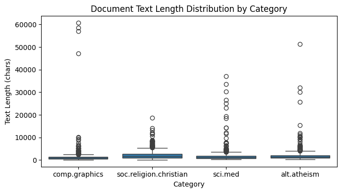
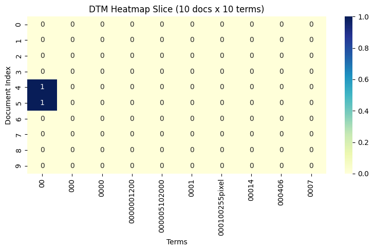
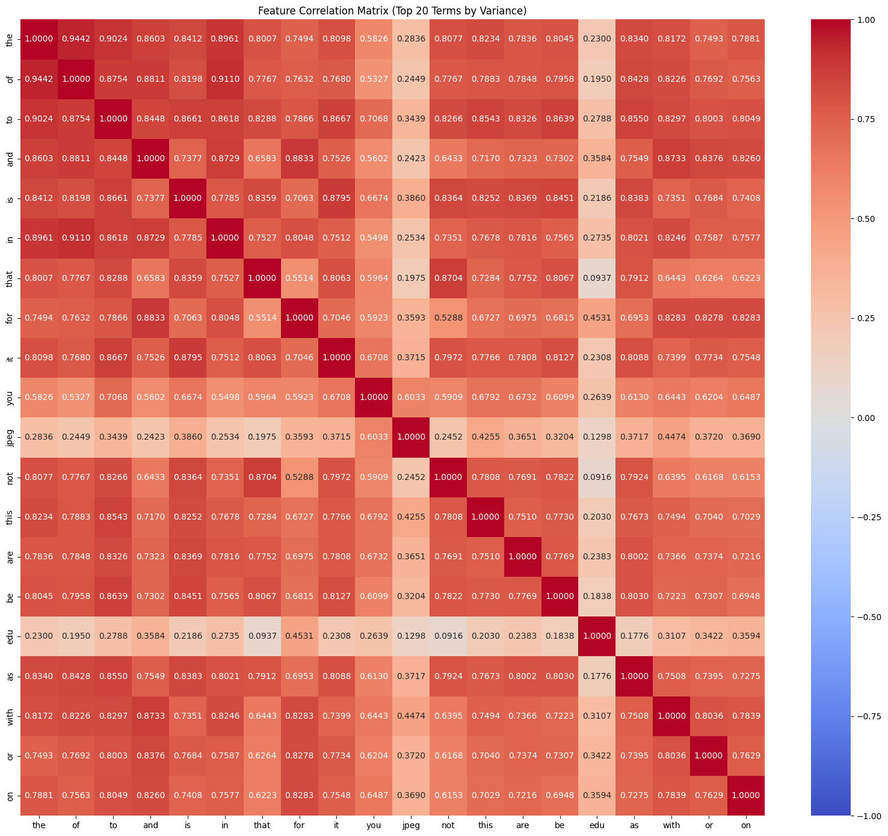
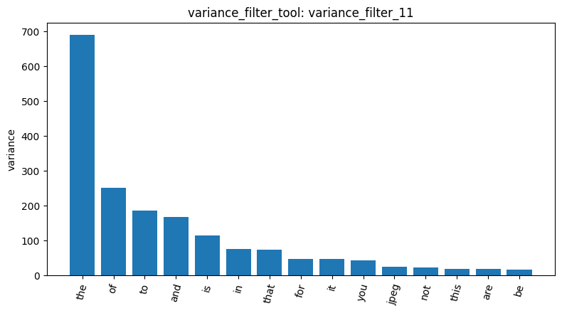
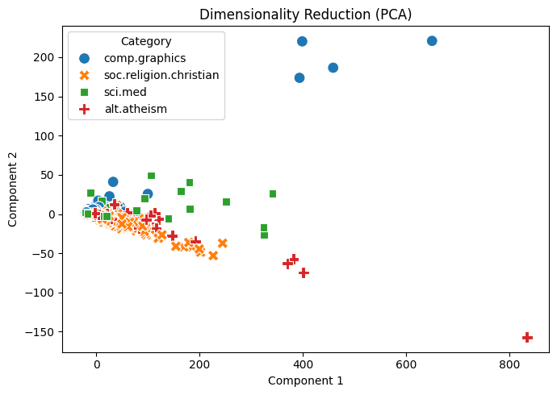

# Your report
## 資料載入與品質檢查

我載入四個類別，共 2,257 篇文章（`load_dataset_1`）。檢查結果顯示，沒有文章缺漏文字（`check_missing_3`），也沒有重複文章（`check_duplicates_4`），因此保留全部資料進行分析。
## 文章長度分布

我使用 `describe_data_5` 比較四個類別的文章長度。`soc.religion.christian` 的中位數最高（1,649 字元），`comp.graphics` 的中位數最低（883 字元）。不過，全資料集中最長的文章也出現在 `comp.graphics`，長達 60,713 字元。

## 文件－詞彙矩陣與特徵篩選

我用預設設定建立了包含 2,257 篇文章、35,788 個詞的文件－詞彙矩陣，稀疏度為 99.547%（`dtm_8`）。前 10 篇文章與前 10 個詞彙欄位的熱圖中，100 格只有 2 格非零（`dtm_heatmap_10`）。以 0.01 為變異數門檻時，有 5,354 個詞達到門檻，30,434 個詞低於門檻（`variance_filter_11`）。

我以 `comp.graphics` 為目標類別，使用 Pearson 相關係數篩選詞彙（`pearson_filter_13`）。門檻設為 0.1，共有 189 個詞達到門檻，其中包含 `vga` 和 `video`。這兩個詞與圖形硬體和影像主題有關，可作為理解篩選結果的例子。

我選取變異數最高的 20 個詞，繪製詞與詞之間的 Pearson 相關係數熱圖（`feature_corr_14`）。入選詞包含 `the`、`of` 等常見詞，也包含 `jpeg`。這顯示高變異的詞同時包含常見用語和較具主題性的詞。

## 頻繁樣式探勘

我對 `alt.atheism` 的文章先做 TF-IDF 詞彙篩選，再用 FP-Growth 探勘頻繁樣式（`mine_patterns_15`）。最低支持度設為 80 篇文章，共找到 4,183 個樣式。`christian` 出現在 82 篇文章中，而 `lines` 與 `subject` 在全部 480 篇文章中共同出現。後者反映文章標頭的固定格式，因此解讀頻繁樣式時，需要考慮這些詞來自文章內容還是標頭。

我也比較了 `comp.graphics` 的第 0 和第 1 篇文章（`cosine_sim_16`）。兩篇文章的詞頻向量餘弦相似度為 0.3532，表示用詞分布有一些重疊。這個結果只代表這一對文章。

## PCA 降維

我使用 PCA 將文件－詞彙矩陣投影到二維（`reduce_dimensions_18`）。第一主成分解釋約 65.94% 的變異，第二主成分解釋約 4.33%，兩者合計約 70.27%。散點圖中的每個點代表一篇文章，顏色代表文章類別。

## 類別標籤二值化

我將 2,257 篇文章的類別標籤轉為 2,257 × 4 的 one-hot 矩陣（`binarize_labels_19`）。四欄依序對應 `alt.atheism`、`comp.graphics`、`sci.med` 和 `soc.religion.christian`。每篇文章在所屬類別的欄位為 1，其餘欄位為 0。