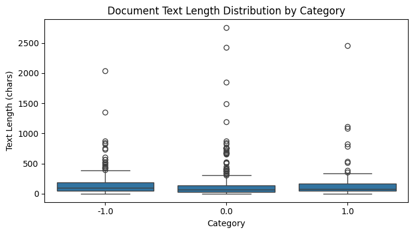
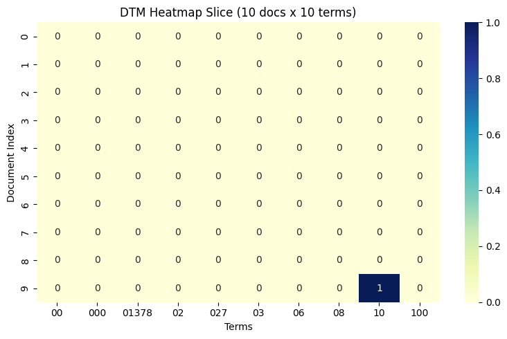
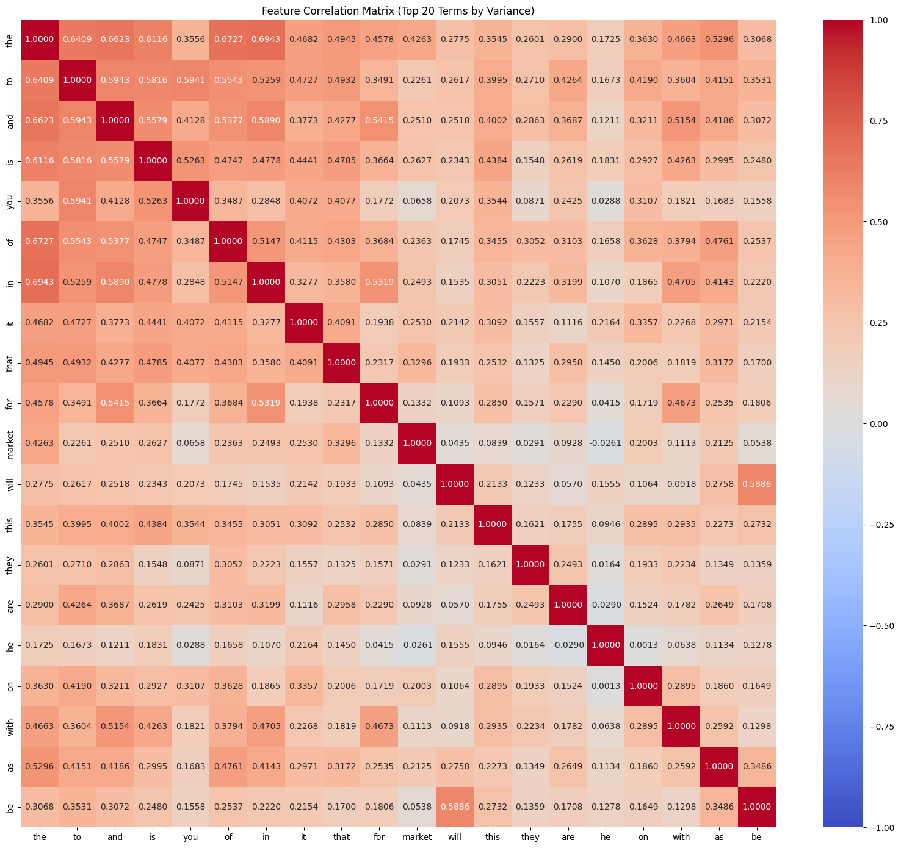
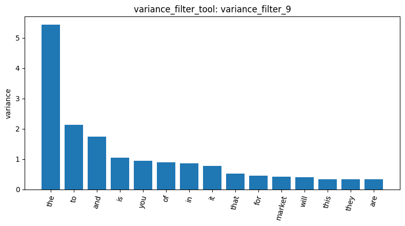
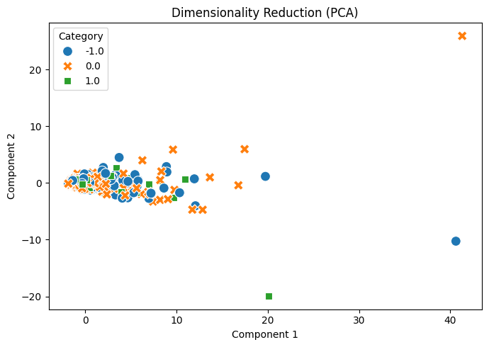

# Your report

# Lab 1 Homework：Reddit 股票情緒分析

我載入了 847 筆 Reddit 股票貼文與留言（`load_dataset_1`）。其中，中立（`0.0`）有 423 筆，負面（`-1.0`）有 315 筆，正面（`1.0`）有 109 筆。三個類別的樣本數不均衡，中立最多，正面最少。

我預覽了前五筆資料（inspect_data_2），確認 text 是貼文內容，`category_name` 保留原始情緒標籤，`category` 則將負面、中立、正面依序編為 0、`1`、`2`。
資料品質檢查發現 0 筆文字缺漏（check_missing_3），並標記了 23 筆重複資料（check_duplicates_4）。這次使用 drop=false，所以保留全部 847 筆供後續分析。

## 文字長度與文件－詞彙矩陣

三種情緒類別的文字長度箱型圖都有高於上鬚的離群值，表示各類別都有少數特別長的貼文或留言。我用預設設定建立了 847 × 4,346 的文件－詞彙矩陣（`dtm_6`），稀疏度為 99.5329%，表示大多數詞在單篇文章中沒有出現。

詞頻統計顯示，`the`（920 次）、`to`（566 次）和 and（488 次）是出現最多的三個詞（term_frequency_7）。這些常見功能詞在整份資料中出現頻繁，下一步可用情緒標籤檢查哪些詞與特定情緒相關。

我繪製了前 10 篇文章與前 10 個詞彙欄位的 DTM 熱圖（`dtm_heatmap_8`）。100 格中只有 1 格非零，代表索引為 9 的文章中，詞彙 `10` 出現了 1 次。這個切片呈現了文件－詞彙矩陣中大量的零值。

以 0.01 為變異數門檻時，4,346 個詞中有 506 個達到門檻，3,840 個低於門檻（variance_filter_9）。

我以正面情緒（1.0）為目標，用 Pearson 相關係數篩選詞彙。門檻設為 0.1，共有 41 個詞達到門檻，例如 huge、`nice` 和 technology（pearson_filter_10）。這些詞在這份資料中與正面標籤呈正相關。

我繪製了變異數最高的 20 個詞之間的相關係數熱圖（`feature_corr_11`），並用長條圖呈現變異數篩選結果（`variance_filter_9`）。

## 頻繁樣式探勘

我對正面情緒（`1.0`）的貼文先做 TF-IDF 詞彙篩選，再用 FP-Growth 探勘頻繁樣式（`mine_patterns_12`）。最低支持度設為 5 篇，共找到 16 個樣式，全部都是單詞。其中 `just` 出現在 15 篇，`good` 出現在 12 篇。在這次的篩選條件與支持度門檻下，沒有任何多詞組合達標。
## PCA 降維

我用 PCA 將 847 篇 Reddit 貼文與留言的詞頻向量投影到二維（`reduce_dimensions_13`）。第一主成分解釋 27.00% 的變異，第二主成分解釋 4.99%，合計 31.99%。散點圖中每個點代表一筆資料，顏色代表情緒類別。這張圖呈現的是原始詞頻變異的一部分。

## 標籤編碼與文件相似度

我將情緒標籤轉成 847 × 3 的 one-hot 矩陣（`binarize_labels_14`），三欄依序對應負面（`-1.0`）、中立（`0.0`）和正面（`1.0`）。我也比較了索引為 1 和 2 的兩則中立貼文，詞頻向量的餘弦相似度為 0.2004（`cosine_sim_15`），顯示這兩則貼文的用詞重疊程度偏低。